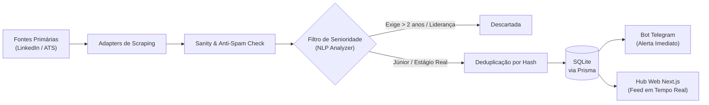

<div align="center">

# 🛰️ DevScout

**O radar autônomo que caça oportunidades de tecnologia Júnior e Estágio reais antes de virarem spam.**

[](https://nextjs.org/)
[](https://www.typescriptlang.org/)
[](https://nodejs.org/)
[](https://www.prisma.io/)
[](https://www.sqlite.org/)
[](https://tailwindcss.com/)
[](https://www.framer.com/motion/)
[](LICENSE)

[Explorar Vagas](/vagas) • [Canal de Alertas no Telegram](https://t.me/) • [Documentação da Arquitetura](#-arquitetura--esteira-de-purifica%C3%A7%C3%A3o)

</div>

---

## 📌 O Problema

A busca pelo primeiro emprego na área de tecnologia (Júnior, Estágio ou Trainee) tornou-se exaustiva e ineficiente:
- **Falsas vagas "Júnior":** Títulos marcados como júnior que exigem 4 a 5 anos de experiência comprovada e liderança de times.
- **Feeds poluídos com spam:** Consultorias que republicam bancos de talentos fantasmas semanalmente para captação de leads.
- **Candidatura tardia:** As vagas são descobertas dias após a publicação, quando a triagem automática já acumula mais de mil inscritos.
- **Testes e formulários sem fim:** Horas gastas em cadastros repetitivos em plataformas com baixíssima taxa de resposta real.

---

## 💡 A Solução: DevScout

O **DevScout** opera como um daemon autônomo de telemetria e agregação inteligente:
1. **Varredura Contínua:** Scrapers coletam vagas em portais, feeds de ATS corporativas (Greenhouse, Lever, Gupy, LinkedIn) e APIs públicas.
2. **Filtro Semântico & Anti-Spam:** Um analisador impiedoso descarta automaticamente vagas com requisitos incompatíveis com o nível inicial (> 2 anos de experiência, ferramentas de senioridade ou termos de liderança).
3. **Deduplicação Determinística:** Gera hashes unificados por empresa, cargo e stack, impedindo o reenvio de vagas duplicadas.
4. **Alerta Instantâneo & Interface Web:** Notificação push via Telegram Bot e disponibilização em tempo real em um catálogo web responsivo e moderno.

```
+-----------------------------------------------------------------------------------+
|  [PORTAIS & ATS]  ->  [ANTI-SPAM & REJEIÇÃO]  ->  [ANALYZER NLP]  ->  [DISPARO]  |
|  LinkedIn/Gupy         Bancos fantasmas           Expurgo de           Telegram   |
|  Greenhouse/Lever      Empresas na blacklist      Sênior disfarçado    & Web Hub  |
+-----------------------------------------------------------------------------------+
```

---

## ✨ Funcionalidades Principais (Key Features)

- 🔍 **Telemetria de Vagas em Tempo Real:** Captura frequente agendada via scheduler/cron.
- 🛡️ **Expurgo Algorítmico de Sênior:** Análise de texto dos requisitos eliminando pedidos absurdos de senioridade.
- ⚡ **Deduplicação por Hash:** Evita repetição da mesma vaga já catalogada em rodadas anteriores.
- 📱 **Alertas Instantâneos no Telegram:** Disparo estruturado com links de candidatura direta para as ATS oficiais.
- 💻 **Interface Web Moderna:**
  - Landing page moderna com animações fluidas (Scroll Reveal, micro-interações, floating terminal e transições suaves com **Framer Motion**).
  - Radar em tempo real com filtros rápidos por ecossistema (React, Node.js, Java, Python, Estágio).
  - Catálogo completo de vagas com busca por texto, filtros laterais, ordenação e paginação rápida.
- 🚀 **Zero Overhead de Infraestrutura:** Execução ultrarrápida usando SQLite local e Prisma ORM.

---

## 🛠️ Stack Tecnológica

| Camada | Tecnologias |
|---|---|
| **Frontend** | [Next.js](https://nextjs.org/) (App Router), [React](https://react.dev/), [TypeScript](https://www.typescriptlang.org/), [Tailwind CSS](https://tailwindcss.com/), [Framer Motion](https://framer.com/motion), [Lucide React](https://lucide.dev/) |
| **Backend / Scraper** | [Node.js](https://nodejs.org/), [TypeScript](https://www.typescriptlang.org/), [Cheerio](https://cheerio.js.org/), [Axios](https://axios-http.com/), [Apify Client](https://docs.apify.com/api/client/js/) |
| **Banco de Dados** | [SQLite](https://www.sqlite.org/) com [Prisma ORM](https://www.prisma.io/) (consultas otimizadas com suporte a busca sem acentos via CTEs) |
| **Automação & Alertas**| [node-cron](https://github.com/node-cron/node-cron), [node-telegram-bot-api](https://github.com/yagop/node-telegram-bot-api) |
| **Testes** | [Vitest](https://vitest.dev/) (unitários de queries, filtros e formatação) |

---

## 🔄 Fluxo de Funcionamento / Pipeline



---

## 🚀 Como Rodar o Projeto

### Pré-requisitos
- **Node.js** v20.x ou superior instalado.
- **npm** (incluso com Node.js).
- *(Opcional)* Token do Telegram Bot e ID do canal caso queira testar os disparos de notificação.

### Passo a Passo

1. **Clonar o repositório:**
   ```bash
   git clone https://github.com/seu-usuario/devscout.git
   cd devscout
   ```

2. **Instalar dependências (Backend e Frontend):**
   ```bash
   # Instala dependências do backend/crawler
   npm install

   # Instala dependências da aplicação Next.js
   cd frontend && npm install && cd ..
   ```

3. **Configurar as Variáveis de Ambiente:**
   Copie o arquivo de exemplo na raiz e defina as variáveis necessárias:
   ```bash
   cp .env.example .env
   ```

4. **Sincronizar o Banco de Dados com Prisma:**
   ```bash
   npx prisma generate
   npx prisma db push
   ```

5. **Iniciar a Aplicação:**

   - **Modo Desenvolvimento Completo (Web + Worker):**
     ```bash
     npm run dev
     ```

   - **Apenas o Frontend Web (Next.js):**
     ```bash
     npm run dev:frontend
     ```
     Acesse no navegador: `http://localhost:3000`

   - **Executar uma rodada avulsa do Crawler/Scraper:**
     ```bash
     npm run worker:run-once
     ```

   - **Executar a suíte de testes:**
     ```bash
     npm run web:test
     ```

---

## ⚙️ Variáveis de Ambiente (`.env`)

| Variável | Obrigatória | Padrão | Descrição |
|---|:---:|---|---|
| `DATABASE_URL` | Sim | `file:./prisma/vagas.db` | String de conexão do Prisma com o SQLite local. |
| `APIFY_API_TOKEN` | Opcional | - | Token de autenticação da conta Apify (para execução de actors externos). |
| `APIFY_LINKEDIN_ACTOR_ID`| Opcional | - | ID do actor do LinkedIn na plataforma Apify. |
| `TELEGRAM_BOT_TOKEN` | Opcional | - | Token do bot gerado pelo `@BotFather` no Telegram. |
| `TELEGRAM_CHAT_ID` | Opcional | - | ID numérico do canal/grupo onde os alertas serão postados. |
| `SCRAPE_INTERVAL_CRON` | Não | `0 */2 * * *` | Expressão cron para periodicidade da varredura contínua. |
| `KEYWORDS_FILTER` | Não | `junior, desenvolvedor...` | Lista de palavras-chave prioritárias para match de vagas. |
| `LOCATION_FILTER` | Não | `Brasil` | Filtro geográfico padrão para seleção de posições. |

---

## 📁 Estrutura de Diretórios

```plaintext
devscout/
├── prisma/
│   ├── schema.prisma        # Modelagem do banco (Job, ExecutionLog)
│   └── vagas.db             # Banco de dados local SQLite
├── src/                     # Núcleo de Scraping, Telemetria e Bot
│   ├── adapters/            # Conectores de coleta (LinkedIn nativo, Apify)
│   ├── analyzer/            # Filtro semântico de senioridade e anti-spam
│   ├── bot/                 # Integração de notificações do Telegram
│   ├── database/            # Repositórios e queries Prisma
│   ├── scheduler/           # Agendador de tarefas periódicas (node-cron)
│   └── index.ts             # Entrypoint do daemon backend
├── frontend/                # Aplicação Web (Next.js 16)
│   ├── src/
│   │   ├── app/             # Rotas do Next.js App Router (Landing, /vagas, APIs)
│   │   ├── components/      # Componentes reutilizáveis de UI
│   │   │   ├── landing/     # Seções da landing com Framer Motion (Hero, Radar, etc.)
│   │   │   └── vagas/       # Componentes do catálogo (JobCard, FilterSidebar, etc.)
│   │   └── lib/             # Helpers puros, tipos, queries do SQLite e testes
├── .env.example             # Modelo de configuração de ambiente
├── package.json             # Scripts e dependências raiz
└── README.md                # Documentação oficial do projeto
```

---

## 📄 Licença

Este projeto está licenciado sob os termos da licença [MIT](LICENSE).

<div align="center">
  <sub>Construído com foco em acessibilidade e transparência para impulsionar desenvolvedores no início de carreira.</sub>
</div>
